<p align="center">
  
</p>

<p align="center">
  <a href="https://www.linkedin.com/in/matheus-furtado-aa0648248/"></a>
  <a href="https://www.instagram.com/mati_souza_/"></a>
  <a href="https://github.com/MatheuSsuza?tab=repositories"></a>
</p>

<p align="center">
  
</p>

<p align="center">
  <a href="#perfil-técnico">Perfil técnico</a> · <a href="#stack">Stack</a> · <a href="#em-estudo">Em estudo</a> · <a href="#estatísticas">Estatísticas</a> · <a href="#contato">Contato</a>
</p>


## Perfil técnico


**Desenvolvedor de Software** com foco em **APIs, automações e aplicações web**. Trabalho com Python, TypeScript, Node.js e Ruby, além de bancos de dados relacionais e Docker.

```typescript
const matheus = {
  usuario: "MatheuSsuza",
  foco: ["APIs", "automações", "aplicações web"],
  linguagens: ["Python", "TypeScript", "Ruby", "SQL"],
  backend: ["Node.js", "Express", "NestJS"],
  dados: ["PostgreSQL", "MySQL"],
  containers: ["Docker"],
  estudando: [
    "Automações com Python",
    "Desenvolvimento de aplicativos Android"
  ]
};
```

<br clear="both" />

## Stack

### 💻 Linguagens

   

### ⚙️ Backend

  

### 🗄️ Bancos de dados

 

### 📦 Containers


<details>
<summary><strong>Como essa stack se conecta às minhas áreas de desenvolvimento</strong></summary>

| Área | Tecnologias e foco |
| :--- | :--- |
| APIs | Node.js, TypeScript, Express e NestJS. |
| Automações | Python para tarefas e rotinas. |
| Aplicações web | Desenvolvimento de aplicações e integração com bancos de dados. |
| Dados | SQL, PostgreSQL e MySQL. |
| Containers | Docker para ambientes de execução. |

</details>


## Em estudo

<p align="center">
  
</p>

<details>
<summary><strong>Ver estudos em texto</strong></summary>

- **Automações com Python:** aprofundamento no desenvolvimento de rotinas para automatizar tarefas.
- **Aplicativos Android:** estudos em desenvolvimento de aplicações para dispositivos móveis.

</details>

## Estatísticas

<p align="center">
  <a href="https://github.com/MatheuSsuza"></a>
</p>

<p align="center">
  <a href="https://github.com/MatheuSsuza"></a>
</p>

<p align="center">
  
  
</p>

<sub>Os cards exibem a atividade pública disponível no GitHub e podem levar algum tempo para atualizar. A stack acima apresenta as tecnologias que utilizo; ela não é calculada a partir desses gráficos.</sub>

## Contato

<p align="center">
  <a href="https://www.linkedin.com/in/matheus-furtado-aa0648248/"></a>
  &nbsp;
  <a href="https://www.instagram.com/mati_souza_/"></a>
</p>

<p align="center"><a href="https://www.linkedin.com/in/matheus-furtado-aa0648248/">Matheus Furtado no LinkedIn</a> · <a href="https://www.instagram.com/mati_souza_/">@mati_souza_ no Instagram</a></p>


<details>
<summary>Créditos visuais</summary>

- Banners e divisórias: [Profile Signal Kit](https://github.com/saroo98/profile-signal-kit).
- Apresentação em código e ilustração: [Anmol098](https://github.com/anmol098/anmol098).
- Painel de estudos: renderizador original da família Terminal do [RyMe.md](https://github.com/ryanpolasky/ryme.md).
- Organização de stack e ícones sociais: [devSouvik](https://github.com/durgeshsamariya/awesome-github-profile-readme-templates/blob/master/templates/devSouvik.md).
- Estatísticas: [GitHub Profile Summary Cards](https://github.com/vn7n24fzkq/github-profile-summary-cards).

</details>
