<!--
GitHub controls the surrounding page theme.
This profile README keeps the visual design inside self-contained SVG assets so it remains stable in light mode and dark mode.
-->

  

 

  

  

  
  

  
  

  

  

  

  

  

Template: [Profile Signal Kit](https://github.com/saroo98/profile-signal-kit).
